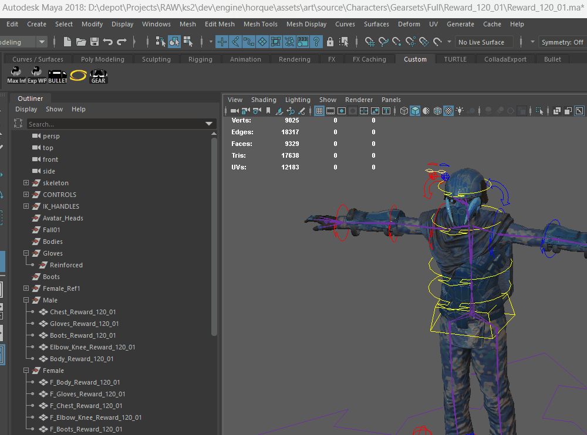
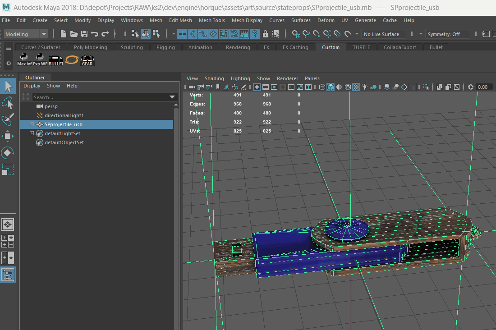

# maya-gear-tool-demo
Maya art tools for gear and art implementation.

# Maya Production Tools

Two tools I built to speed up asset setup and reduce manual entry errors.

## Gearset entry generator

Artists enter an asset name, gear-piece types, and armor status. The tool validates the inputs, then generates the entry and copies it to the clipboard.

## Bullet tool

[Add one sentence explaining what the Bullet tool automates and what the artist receives.]

